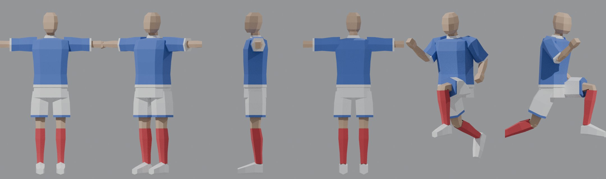
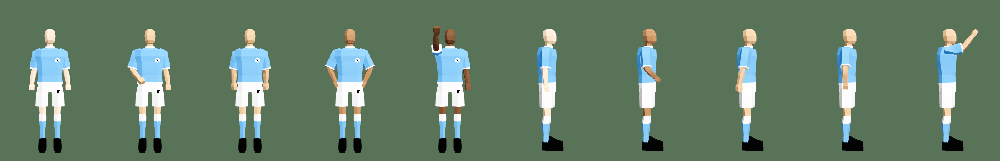
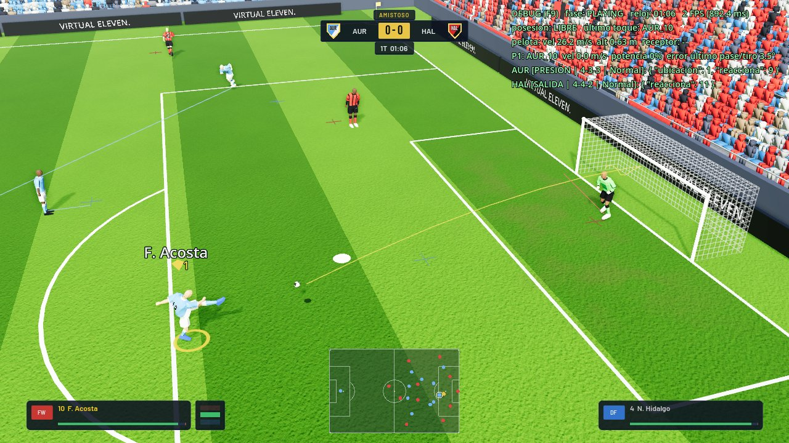

# Diseño Definitivo WE

El jugador nuevo de Virtual Eleven, copiado del estilo de ForeverEleven /
Winning Eleven 2002: pocos polígonos, caras planas, camiseta suelta y
cuadrada, short ancho, medias hasta la rodilla, botines en bloque y puños.
Es el estilo **por defecto** (Partido > Jugadores: "Diseño Definitivo WE").

**Etapa 1 (esta):** todos pelados y sin cara. El pelo y la cara se diseñan
más adelante sobre el mismo modelo.

## Archivos

| Archivo | Qué es |
|---|---|
| `tools/blender/we_definitivo.py` | Arma el modelo desde cero (script de Blender). |
| `tools/blender/we_definitivo.blend` | El modelo para editarlo a mano en Blender. |
| `tools/blender/we_preview.py` | Saca fotos del modelo (pose T y de carrera). |
| `assets/models/players/we_definitivo.glb` | Lo que carga el juego (exportado del .blend). |
| `scripts/player/we_body.gd` | Lo pone sobre el esqueleto del juego y le pasa las zonas al shader. |

`tools/blender/` tiene `.gdignore`: Godot no importa el `.blend`.

## Cómo está hecho

- **Esqueleto:** el mismo del juego (`player_body.gltf`, 1,81 m, pose T), con
  los mismos nombres de huesos (`pelvis`, `spine_01..03`, `neck_01`, `Head`,
  `clavicle/upperarm/lowerarm/hand_l/_r`, `thigh/calf/foot/ball_l/_r`). Por eso
  el modelo usa todas las animaciones del juego, y las animaciones propias que
  se hagan en Blender sobre este Armature van a servir para todos.
- **Malla:** unos 750 triángulos. Tubos de 4 a 8 caras por anillo. Caras
  planas (Shade Flat), sin texturas.
- **Pesos rígidos:** cada anillo va a un hueso. En codos, rodillas, cintura,
  cuello, tobillos y hombros, el anillo de la articulación va mitad y mitad, para
  que no se abra al doblar.
- **Zonas = materiales.** El color de cada material es sólo para verlo en
  Blender: en el juego cada zona se pinta con los colores del club, el diseño
  de la camiseta (rayas, bastones, banda...), el número y el escudo.

| Material | Zona en el juego |
|---|---|
| `camiseta` | Torso: lleva el diseño, el número de la espalda y el escudo. |
| `manga` | Mangas (color de la camiseta, sin número). |
| `ribete_camiseta` | Cuello, puños y ruedo: color secundario. |
| `short` | Short (con el número en el muslo izquierdo). |
| `ribete_short` | Ruedo del short. |
| `medias` | Medias (con la franja de arriba). |
| `piel` | Piel (cara, cuello, brazos, rodillas). |
| `botines` | Botines. |
| `pelo` | Pelo (todavía sin usar: pelados). |
| `manos` | Manos (guantes en los arqueros). |

## Editar el modelo a mano

1. Abrí `tools/blender/we_definitivo.blend` (Blender 4.2 o más nuevo).
2. Editá en modo edición **sin mover el Armature ni salir de la pose T**.
   Respetá la altura (1,81 m), porque el número y el escudo se ubican por
   posición: la espalda va de y 1,12 a 1,42 m y el pecho, a la altura de 1,33 m.
3. Las caras nuevas tienen que tener un material de la tabla y pesos en
   los grupos de vértices (los nombres de los huesos).
4. Exportá: File > Export > glTF 2.0, formato **glTF Binary (.glb)**, a
   `assets/models/players/we_definitivo.glb`. Opciones: Include > Selected
   Objects (Armature + WE_Definitivo), Data > Armature/Skinning activado,
   Animation desactivado.

Para volver a generarlo desde cero (pisa el .blend y el .glb):
`blender --background --python tools/blender/we_definitivo.py`.

## Próximos pasos

1. **Pelo y cara:** bloques de pelo (material `pelo`) y rasgos simples, como
   en las referencias.
2. **Animaciones propias** (reemplazan a las de Mixamo y a la librería
   actual), hechas en Blender sobre este Armature. Primero correr (rodilla
   adelante a 90°, codos a 90°, como el WE2002), trotar, caminar y parado;
   después pase, remate, cabezazo, barrida y arquero.
